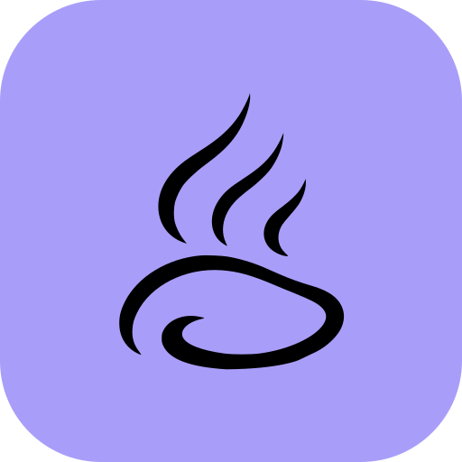

<p align="center"></p>

# ravi

ravi is a local code review tool with a GitHub/GitLab-like UI. It reviews local git changes and
GitHub.com/GitLab.com pull requests, keeps comments as drafts until you press **Send**, and exports
the whole review as one Markdown file that AI agents can read and extend. It ships as one JavaScript
file that runs on Node with the UI embedded.

[](https://github.com/CaffeinatedPinguin/ravi/actions/workflows/ci.yml)
[](https://github.com/CaffeinatedPinguin/ravi/releases/latest)
[](LICENSE)

**Status:** active, maintained by one person on a best-effort basis. Issues are welcome; outside
pull requests are not accepted. See [CONTRIBUTING.md](CONTRIBUTING.md).

## Features

- **Dashboard:** connected repositories, local changes, pull requests waiting for your review, your
  own pull requests, and a review-later list.
- **Local review:** uncommitted, staged, unstaged, branch against base, and commit ranges. File tree,
  split or unified view, syntax highlighting, ignored whitespace, and expandable context.
- **Pull request review:** GitHub.com and GitLab.com, file threads, the conversation, review-later,
  and a three-dot diff like the forge's "Files changed" view.
- **Comments:** drafts, replies, edits, images, outdated markers, and Approve / Request changes.
- **Markdown v1:** Copy, Save, and Import one self-explaining file for AI agents.
- **Notifications:** a background poller with author and text filters, plus a filter preview.
- **Security:** a loopback-only server, session cookie, CSRF header, strict security headers, a
  server image proxy, and tokens that never reach the browser.
- **Performance:** virtualized diff rendering that stays smooth with thousands of changed files.

## Install

ravi needs Node 22.20 or newer and git. Download the installer for your system from the
[latest release](https://github.com/CaffeinatedPinguin/ravi/releases/latest) and run it. You do not
need the other files on that page.

| System | Download | Run |
|---|---|---|
| Windows | `install-windows.ps1` | `powershell -ExecutionPolicy Bypass -File .\install-windows.ps1` |
| macOS | `install-macos.sh` | `sh install-macos.sh` |
| Linux | `install-linux.sh` | `sh install-linux.sh` |

On Windows, run the command from PowerShell in the download folder so you can see the output.
Windows blocks downloaded scripts by default, which is why the command passes
`-ExecutionPolicy Bypass`.

### What the installer does

The installers are plain scripts; read one before you run it. Each one:

- checks that Node and git are installed;
- downloads `ravi.mjs` from the latest release;
- writes a launcher and adds it to your `PATH`;
- needs no administrator rights;
- contacts only `api.github.com` and `github.com`.

### Where it installs

| System | Program and data | Launcher | `PATH` change |
|---|---|---|---|
| Windows | `%LOCALAPPDATA%\Programs\ravi` | `ravi.cmd`, same folder | your user `PATH` |
| macOS | `~/.local/share/ravi` | `~/.local/bin/ravi` | two lines in `~/.zshrc` (`~/.bash_profile` for bash) |
| Linux | `~/.local/share/ravi` | `~/.local/bin/ravi` | two lines in `~/.bashrc` (`~/.zshrc` for zsh), only if `~/.local/bin` is not in `PATH` yet |

ravi keeps reviews, settings and the `.env` file with your tokens in the same folder as the program.
The launcher sets `RAVI_HOME` to that folder; run `ravi --help` to see it. If you used an earlier
release, which kept its data in `~/.ravi`, the installer shows the command to copy it over.

### Offline install

Download `ravi.mjs` from the release as well and pass it to the installer:
`-LocalFile .\ravi.mjs` on Windows, `sh install-linux.sh ./ravi.mjs` on Linux and macOS. Set
`RAVI_PREFIX` (macOS and Linux) or pass `-InstallDir` (Windows) to install somewhere else.

## Start ravi

Open a new terminal. Terminals that were already open do not see the `PATH` change. Go to a folder
with a git repository and run:

```sh
ravi                          # open the repository in the current folder
ravi path/to/repo             # open another repository
ravi --help                   # all options
```

ravi opens the review in your browser and keeps running in that terminal. Press `Ctrl+C` to stop it.
Running `ravi` again while it is running only opens the browser. On the first run, the dashboard
asks you to add a repository: choose a local folder or paste a GitHub/GitLab URL. Application data,
including the token file, lives in the install folder (see the table above).

## Tokens and permissions

Git can fetch code with your own credentials (SSH keys or HTTPS), but pull requests, their
conversations and sending a review are not part of git: they come from the GitHub/GitLab API, which
accepts only a token. Without a token ravi still reviews local changes, a branch against its base and
commit ranges; pull request features need the token.

For a GitHub fine-grained token, limit it to the repositories you review:

| Permission | What ravi uses it for |
|---|---|
| Pull requests: Read and write | Lists and reads pull requests and their threads; write is used only by Send, for inline comments, replies, edits and Approve / Request changes. On a pull request it also covers the conversation comments. |
| Contents: Read-only | Git over HTTPS fetches the pull request's commits and files; private repositories need it. |
| Metadata: Read-only | Added automatically by GitHub. |

A classic token works too: scope `repo` for private repositories, or `public_repo` for public ones only.

For GitLab, a personal access token:

| Permission | What ravi uses it for |
|---|---|
| `api` | Reads merge requests, their discussions and approvals and, on Send, writes notes, uploads pasted images and approves; git over HTTPS is covered by it. |

`read_api` + `read_repository` is enough for reading only; Send will fail. Nothing else is needed: no
admin, no workflow, no user or email permissions. ravi never writes to the forge except through Send.

ravi keeps tokens only in the `.env` file in its data folder, the install folder from the table above;
`ravi --help` prints it. Add a token in Settings -> Accounts (one per host, used for every repository
on that host) or in Repositories (one for a single repository, which wins over the host token). ravi
shows only the last four characters afterwards and never sends a token to the browser, logs or
exports. For read-only use, drop the write level (Pull requests: Read-only): listing and reading work
and Send is refused by GitHub.

Two common problems: "token missing" on the dashboard means no token for that host; on the
Repositories page, Test connection shows Git and API results separately, and Git OK with API failed
means the token is missing or lacks the Pull requests permission. ravi clones remote repositories
over HTTPS using the token; local folders use your own git credentials.

## Update and uninstall

To update, run the installer again. It compares your version with the latest release and downloads
only when there is a newer one.

To uninstall, delete the program folder and the launcher listed in the table above and remove the
`PATH` entry (the installer prints the exact steps at the end). The folder also holds your reviews and
tokens, so copy them out first if you want to keep them.

## Built with

TypeScript, Node, React, Vite, Shiki, markdown-it, Zod, Playwright in Microsoft Edge, and Vitest.

## Documentation

Architecture, the forge layer, and the review Markdown format are in [docs/index.md](docs/index.md).

## Security

ravi runs locally and holds forge tokens, so the server binds `127.0.0.1`, checks the `Host` header,
requires a session cookie, adds a CSRF header to mutating calls, passes git arguments as an array,
and keeps tokens in the `.env` file of its data folder only. To report a vulnerability, follow
[SECURITY.md](SECURITY.md).

## License

Copyright (C) 2026 smrodek.xyz. Licensed under the GNU Affero General Public License v3.0 only; see
[LICENSE](LICENSE).

## Open-source packages

ravi builds on React, Vite, Shiki, markdown-it, Zod, and TanStack Virtual. Direct dependencies are
listed in [package.json](package.json); `pnpm-lock.yaml` pins the full tree.
